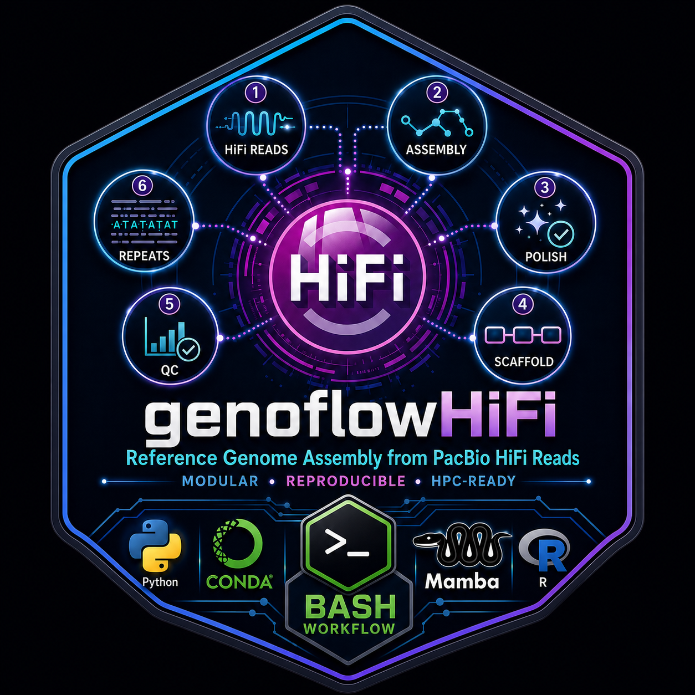

# genoflowHiFi

<a href="https://doi.org/10.5281/zenodo.21650437">
  
</a>

Reproducible Bash workflows for PacBio HiFi genome assembly, optional Hi-C scaffolding, and functional annotation.

## Public release scope

This repository releases three Bash workflows:

| Script | Purpose |
|---|---|
| `genoflowHiFi_v0.9.14.sh` | PacBio HiFi assembly, long-read scaffolding, polishing, evaluation, repeat annotation, and reporting without requiring Hi-C |
| `genoflowHiFi_HiC_v0.1.0.sh` | PacBio HiFi assembly with Hi-C scaffolding, manual curation, polishing, evaluation, repeat annotation, and reporting |
| `functional_annotation_v2.sh` | RNA-seq processing, protein functional annotation, consensus tables, and descriptive expression and genome-annotation graphics |

Other development Bash workflows are not part of this public distribution.

`functional_annotation_v2_R/` contains the three R helpers used by the public functional-annotation workflow. They are supporting source files, not additional Bash workflows.

## 1. HiFi genome assembly

`genoflowHiFi_v0.9.14.sh` assembles PacBio HiFi reads without requiring Hi-C data. Its default workflow runs Hifiasm, optional FCS decontamination, DeepVariant pre-polishing, Inspector correction, LongStitch scaffolding and candidate selection, final polishing and FCS cleanup, assembly evaluation, repeat annotation, and reporting. Scaffolding uses HiFi reads when optional PacBio CLR reads are not supplied. The script also exposes an optional Hifiasm Hi-C phasing mode (`HIFIASM_USE_HIC=TRUE`); leave it disabled for HiFi-only assembly.

Review the project and software configuration near the top of the script before running it. The supplied paths and taxonomy are project-specific defaults, not portable settings. Configure the Miniforge environments, executables, containers, databases, taxonomy, resources, and enabled stages for the target system. The optional pre-converted HiFi FASTA has a project-specific default and must also be set to a valid local file when used.

```bash
working_dir="/path/to/project" \
pacbio_hifi="/path/to/hifi_reads.fastq.gz" \
pacbio_hifi_fasta="/path/to/hifi_reads.fasta.gz" \
TAXID="13604" \
BUSCO_LINEAGE="actinopterygii_odb12.2" \
HIFIASM_USE_HIC=FALSE \
bash genoflowHiFi_v0.9.14.sh
```

Stage switches include `run_hifiasm`, `run_fcs_early`, `run_deepvariant`, `run_inspector`, `run_scaffolding`, `run_final_asm`, `run_stats`, and `run_repeats`. Each defaults to `TRUE`; disabling a stage requires its downstream inputs to exist. The primary final assembly is `06.final_asm/<Scientific_Name>.fasta`; evaluation, repeats, and summaries are stored under `07.asm_stats/`, `08.repeats/`, and `09.summary/`.

## 2. HiFi plus Hi-C genome assembly

`genoflowHiFi_HiC_v0.1.0.sh` implements the following stages:

```text
PacBio HiFi reads + paired Hi-C reads
        |
Hifiasm primary assembly
        |
Optional FCS-Adaptor and FCS-GX decontamination
        |
DeepVariant pre-polishing
        |
Inspector correction
        |
Chromap alignment and YaHS scaffolding
        |
Required manual YaHS/JBAT curation
        |
TGS-GapCloser2 gap filling
        |
Final DeepVariant polishing and optional FCS-GX cleanup
        |
QUAST, BUSCO, BlobToolKit, Qualimap, and MultiQC evaluation
        |
RepeatModeler2, TEtrimmer, RepeatMasker, and Earl Grey
        |
Final assembly and run summary
```

The primary assembly is written to:

```text
07.final_asm/<Scientific_Name>.fasta
```

### Required two-pass execution

The workflow has a hard manual-curation boundary after YaHS Step 5.

Pass 1 creates the YaHS scaffolds and JBAT curation bundle:

```bash
working_dir="/path/to/project" \
pacbio_hifi="/path/to/hifi_reads.fastq.gz" \
pacbio_hifi_fasta="/path/to/hifi_reads.fasta.gz" \
hic_r1="/path/to/hic_R1.fastq.gz" \
hic_r2="/path/to/hic_R2.fastq.gz" \
TAXID="13604" \
BUSCO_LINEAGE="actinopterygii_odb12" \
run_hifiasm=TRUE \
run_fcs_early=TRUE \
run_deepvariant=TRUE \
run_inspector=TRUE \
run_yahs=TRUE \
run_tgsgapcloser2=FALSE \
run_final_asm=FALSE \
run_stats=FALSE \
run_repeats=FALSE \
bash genoflowHiFi_HiC_v0.1.0.sh
```

Curate the JBAT assembly and save the curated FASTA. The default handoff path is:

```text
05.yahs/curated_assembly/<base>.curated.fa
```

Pass 2 resumes from that curated assembly:

```bash
working_dir="/path/to/project" \
pacbio_hifi="/path/to/hifi_reads.fastq.gz" \
pacbio_hifi_fasta="/path/to/hifi_reads.fasta.gz" \
hic_r1="/path/to/hic_R1.fastq.gz" \
hic_r2="/path/to/hic_R2.fastq.gz" \
curated_assembly="/path/to/project/05.yahs/curated_assembly/<base>.curated.fa" \
TAXID="13604" \
BUSCO_LINEAGE="actinopterygii_odb12" \
run_hifiasm=FALSE \
run_fcs_early=FALSE \
run_deepvariant=FALSE \
run_inspector=FALSE \
run_yahs=FALSE \
run_tgsgapcloser2=TRUE \
run_final_asm=TRUE \
run_stats=TRUE \
run_repeats=TRUE \
bash genoflowHiFi_HiC_v0.1.0.sh
```

Important configuration variables are defined near the top of the script. Local executable, database, container, taxonomy, and input paths must be reviewed before execution.

### Assembly output layout

```text
01.hifiasm/          Primary assembly
02.fcs_decontam/    FCS screening and cleanup
03.deepvariant/     Pre-scaffold polishing
04.inspector/       Assembly correction
05.yahs/            Hi-C alignment, YaHS scaffolds, and curation handoff
06.tgsgapcloser2/   Gap-closing outputs
07.final_asm/       Final assembly
08.asm_stats/       Assembly evaluation
09.repeats/         Repeat libraries and annotations
10.summary/         Final run summaries
```

## 3. Functional annotation

`functional_annotation_v2.sh` provides modular stages for:

- SRA download and FASTQ conversion.
- `fastp` quality control and trimming.
- HISAT2 alignment and indexed BAM generation.
- Gene-level counting with `Rsubread::featureCounts`.
- eggNOG-mapper annotation.
- InterProScan domain and protein-family annotation.
- DIAMOND searches against curated Swiss-Prot proteins.
- KofamScan KEGG Orthology assignment.
- Optional dbCAN CAZyme annotation.
- Consensus tables and descriptive RNA-seq and genome-annotation graphics.

The expression component supports descriptive fold-change plots for designs with one sample per organ. These outputs are not formal differential-expression tests because biological replication is absent.

### Run modes

| `RUN_MODE` | Behavior |
|---|---|
| `annotation_only` | Runs the five protein-annotation methods; this is the default |
| `all` | Enables all processing, annotation, and plotting stages |
| `plots_only` | Generates the R-based tables and plots from existing inputs |
| `preflight` | Validates all enabled inputs, databases, environments, and tools without running stages |
| `startup_check` | Exercises initialization with all stages disabled |
| `custom` | Uses only explicitly supplied `RUN_*` stage switches |

Basic invocation:

```bash
PROJECT_DIR="/path/to/project" \
EGAPX_OUT_DIR="/path/to/egapx/out" \
RUN_MODE="annotation_only" \
bash functional_annotation_v2.sh 8 4
```

The two positional arguments are threads per job and parallel jobs. Every study-specific path and stage switch can be overridden with environment variables.

The default sample metadata contains the four SRA accessions used in the associated study. Supply `01_metadata/sra_metadata.tsv` or set `RUN_CREATE_METADATA=TRUE` with an edited accession table for another study.

### Required R helpers

The following files must remain beside the Bash script under `functional_annotation_v2_R/`:

```text
run_featurecounts_rsubread.R
rnaseq_single_sample_plots.R
egapx_genome_annotation_graphics_karyoploter.R
```

Alternatively, set `R_SOURCE_DIR`, `FEATURECOUNTS_R_SOURCE`, `RNASEQ_R_SOURCE`, and `GENOME_GRAPHICS_R_SOURCE` to external copies.

### Functional-annotation output layout

```text
00_logs/                    Logs and stage manifests
01_metadata/                SRA and sample metadata
02_sra/                     SRA downloads
03_fastq/                   Raw FASTQ files
04_fastp/                   Trimmed reads and fastp reports
05_multiqc/                 MultiQC reports
06_hisat2/                  HISAT2 index, BAM files, and summaries
07_featurecounts/           Gene-count tables
08_eggnog_mapper/           eggNOG-mapper outputs
09_interproscan/            InterProScan outputs
10_diamond_annotation/      DIAMOND/Swiss-Prot outputs
11_kofamscan/               KofamScan outputs
12_dbcan/                   dbCAN outputs
13_consensus_annotation/    Combined tables, scripts, and plots
```

## Installation and dependencies

Clone the repository and make the public Bash workflows executable:

```bash
git clone https://github.com/bferrette/genoflowHiFi.git
cd genoflowHiFi
chmod 755 genoflowHiFi_v0.9.14.sh genoflowHiFi_HiC_v0.1.0.sh functional_annotation_v2.sh
```

The workflows coordinate external software; they do not install it. Major assembly dependencies include Hifiasm, DeepVariant, Inspector, LongStitch (ntLink, ARKS, and optionally Tigmint), genoflowSTATS, yak, Merqury, Chromap, YaHS, TGS-GapCloser2, QUAST, BUSCO, BlobToolKit, RepeatModeler2, Terrier, TEtrimmer, RepeatMasker, Earl Grey, GNU Parallel, and Apptainer or Singularity. Dependencies vary with the workflow and enabled stages; the HiFi-only workflow requires a compatible genoflowSTATS installation in its configured environment for scaffolding and assessment.

Major functional-annotation dependencies include SRA Toolkit, `fastp`, HISAT2, SAMtools, GNU Parallel, MultiQC, eggNOG-mapper, InterProScan, DIAMOND, KofamScan, dbCAN, mamba, and R with the packages declared in `R_REQUIRED_PACKAGES`.

Exact versions, environment names, paths, databases, and optional stages are recorded in the scripts. Full production runs require substantial storage and compute resources.

The optional definitions under `containers/` document BlobToolKit, GATK 4, and
TE-tools container builds. They do not install or build containers automatically.

## Validation

Syntax validation:

```bash
bash -n genoflowHiFi_v0.9.14.sh
bash -n genoflowHiFi_HiC_v0.1.0.sh
bash -n functional_annotation_v2.sh
```

Static analysis, when ShellCheck is installed:

```bash
shellcheck -x genoflowHiFi_v0.9.14.sh
shellcheck -x genoflowHiFi_HiC_v0.1.0.sh
shellcheck -x functional_annotation_v2.sh
```

Low-impact initialization check for the annotation workflow:

```bash
project_dir="$(mktemp -d)"
PROJECT_DIR="${project_dir}" RUN_MODE=startup_check \
  bash functional_annotation_v2.sh 1 1
```

These checks do not replace validation on representative sequencing and annotation data.

## Citation and Zenodo

The latest archived release is available through the
[Zenodo concept DOI](https://doi.org/10.5281/zenodo.21650437). This DOI resolves
to the most recent archived version.

For reproducible scientific citation of the archived 0.1.0 release, use its
version-specific DOI. That archive predates the addition of the HiFi-only script;
cite a future version-specific DOI once a new release containing it is archived.

```text
Version DOI: 10.5281/zenodo.21650438
Concept DOI: 10.5281/zenodo.21650437
```

```text
Ferrette, B. L. S. (2026). genoflowHiFi: PacBio HiFi–Hi-C Genome Assembly and
Functional Annotation Workflows (version 0.1.0). Zenodo.
https://doi.org/10.5281/zenodo.21650438
```

The version DOI identifies the exact archived release used in an analysis. The
concept DOI identifies the software project and resolves to its latest Zenodo
version.

## License

This software is distributed under the GNU General Public License v3.0. See `LICENSE`.
